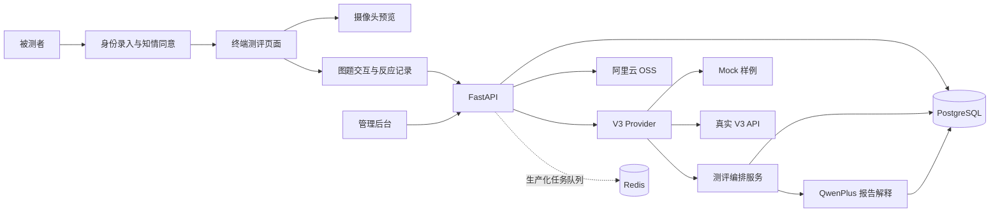

# 高责任岗位与公益心理测评系统

面向航空飞行员、轨道交通、应急救援等高责任岗位的日常心理状态监测，同时兼顾社区、校园等公益心理健康筛查场景。

系统通过约 60 秒的“情绪诱发图片 + 即时双选题”交互采集用户反应，并预留摄像头视频分析链路；后端调用合作方 V3 心理生理状态算法生成结构化结果，再由 QwenPlus 将专业指标转成面向用户的自然语言报告。

> 本项目定位为心理状态辅助筛查和趋势监测工具，不构成临床诊断。

## 当前状态

项目目前处于 Demo 阶段：

- 已完成 FastAPI、PostgreSQL、Redis、结构化日志和环境变量管理。
- 已完成图题库、随机会话调度和批量数据注入脚本。
- 已完成 V3 Provider 抽象，可在 Mock 与真实 API 之间切换。
- 已完成 QwenPlus 个性化报告生成及结果落库。
- 已完成被测者登录页、60 秒测评端和管理后台。
- 当前用户端即时报告仍使用 Mock 内容，完整 V3/Qwen 结果在管理后台查看。
- 真实视频录制、上传和 V3 分析链路仍待接通。

## 系统架构



一次测评的核心数据流：

```text
身份录入
  → 知情同意与摄像头预览
  → 图题会话与反应记录
  → 创建测评任务
  → V3 上传 / 建任务 / 轮询 / 解析
  → 结构化结果落库
  → QwenPlus 生成报告
  → 管理后台查看与跟进
```

## 技术栈

- 后端：Python 3.12、FastAPI、SQLAlchemy 2.0 Async、Pydantic Settings
- 数据库与缓存：PostgreSQL 16、Redis 7
- 前端：Vue 3 Global Build、Tailwind CSS CDN、原生浏览器 API
- AI：合作方 V3 心理生理状态算法、阿里云百炼 QwenPlus
- 对象存储：阿里云 OSS
- 基础设施：Docker Compose、Adminer
- 测试与质量：pytest、pytest-asyncio、Ruff

## 页面入口

服务启动后可访问：

| 地址 | 说明 |
| --- | --- |
| `http://localhost:8000/login` | 被测者身份录入入口 |
| `http://localhost:8000/demo` | 终端测评页面 |
| `http://localhost:8000/admin` | 测评管理后台 |
| `http://localhost:8000/docs` | Swagger API 文档 |
| `http://localhost:8000/health` | 服务及数据库健康检查 |
| `http://localhost:8080` | Adminer 数据库管理页面 |

## 目录结构

```text
psych-project/
├─ backend/
│  ├─ app/
│  │  ├─ api/routes/           # 健康检查、测评、图题、上传、后台接口
│  │  ├─ core/                # 配置与日志
│  │  ├─ db/                  # SQLAlchemy 引擎和会话
│  │  ├─ models/              # 测评结果与图题库 ORM
│  │  ├─ schemas/             # Pydantic 请求/响应模型
│  │  ├─ services/
│  │  │  ├─ assessment.py     # 测评任务编排
│  │  │  ├─ scheduler.py      # 图题随机调度
│  │  │  ├─ v3/               # Mock/Real V3 Provider
│  │  │  ├─ qwen/             # QwenPlus 客户端与报告 Prompt
│  │  │  └─ oss/              # 阿里云 OSS 客户端
│  │  ├─ static/              # login、demo、admin 单文件页面
│  │  └─ main.py              # FastAPI 应用入口
│  └─ tests/
├─ scripts/
│  ├─ env_check.sh            # 环境诊断
│  └─ seed_image_bank.py      # 图题库导入与题目刷新
├─ docs/                      # 架构、协议与数据字典沉淀目录
├─ ziliao/                    # 本地参考资料，默认不提交 Git
├─ docker-compose.yml
├─ Makefile
└─ .env.example
```

## 快速开始

### 1. 创建环境

```bash
python -m venv .venv
```

Linux、macOS 或 Git Bash：

```bash
source .venv/bin/activate
cd backend
pip install -e ".[dev]"
cd ..
```

Windows PowerShell：

```powershell
.\.venv\Scripts\Activate.ps1
cd backend
pip install -e ".[dev]"
cd ..
```

### 2. 配置环境变量

```bash
cp .env.example .env
```

Windows PowerShell：

```powershell
Copy-Item .env.example .env
```

Mock 模式无需 V3 凭证即可运行。需要生成真实 Qwen 报告或使用 OSS 时，请在 `.env` 中填写相应凭证。

### 3. 启动基础设施

```bash
docker compose up -d
```

这会启动 PostgreSQL、Redis 和 Adminer。

### 4. 启动后端

```bash
cd backend
uvicorn app.main:app --reload --host 0.0.0.0 --port 8000
```

## Mock 与真实 V3

默认使用 Mock：

```dotenv
PROVIDER_MODE=mock
```

Mock Provider 会回放真实结构的 fixture，并对部分分数进行小幅随机扰动，便于连续演示。

切换真实接口：

```dotenv
PROVIDER_MODE=real
V3_API_ROOT=https://example.com
V3_BASIC_TOKEN=
V3_ALG_SERVICE_UUID=
V3_OSS_BUCKET_ID=1
```

真实模式执行：

```text
上传视频 → 创建算法任务 → 轮询任务状态 → 获取结构化结果
```

当前终端页面尚未把摄像头流录制成文件并提交给后端，因此真实模式仍需补齐视频采集上传接口。

## 图题库

抓取 Demo 图片并自动配题：

```bash
python scripts/seed_image_bank.py --fetch 24
```

从本地目录上传：

```bash
python scripts/seed_image_bank.py --dir path/to/images
```

通过 CSV 精确导入图题：

```bash
python scripts/seed_image_bank.py --csv questions.csv
```

保留现有图片并刷新题目：

```bash
python scripts/seed_image_bank.py --requestion
```

图题选项仅用于增强认知参与和记录行为反应，不直接作为心理评分。

## API 概览

| 方法 | 路径 | 说明 |
| --- | --- | --- |
| `GET` | `/health` | 服务和数据库健康状态 |
| `GET` | `/api/v1/pairs/session` | 获取一组不重复图片的图题会话 |
| `GET` | `/api/v1/pairs/next` | 获取下一条图题 |
| `POST` | `/api/v1/uploads/images` | 上传图片到 OSS |
| `POST` | `/api/v1/assessments` | 创建测评并启动后台分析 |
| `GET` | `/api/v1/assessments` | 查询测评列表 |
| `GET` | `/api/v1/assessments/{id}` | 查询测评详情与报告 |
| `POST` | `/api/v1/admin/login` | 校验 Demo 管理口令 |
| `PUT` | `/api/v1/admin/assessments/{id}/info` | 修改被测者基础信息 |
| `PATCH` | `/api/v1/admin/assessments/{id}/note` | 修改内部备注 |
| `PATCH` | `/api/v1/admin/assessments/{id}/review-status` | 更新跟进状态 |

创建测评示例：

```bash
curl -X POST http://localhost:8000/api/v1/assessments \
  -H "Content-Type: application/json" \
  -d '{
    "subject_id": "pilot-001",
    "name": "测试用户",
    "id_card": "110101199001011234"
  }'
```

## 测试与代码质量

激活虚拟环境后运行：

```bash
cd backend
pytest -q
ruff check .
```

已有测试覆盖健康检查、V3 Mock Provider、Qwen Prompt/报告调用和 OSS 客户端基础行为。

## 生产化待办

- 浏览器视频录制、上传及真实 V3 端到端链路
- Celery/Arq 任务队列、持久化重试和超时处理
- Alembic 数据库迁移
- 管理员账号体系、服务端会话/JWT、RBAC 和审计日志
- 身份证等敏感信息的加密、脱敏、留存与销毁策略
- V3 临时 timeline 地址转存自有 OSS
- WebSocket 时隙协议与多模态时间戳对齐
- 移除前端 CDN 依赖，支持终端断网运行
- 云端部署、监控告警、硬件适配及验收

## 安全提示

- `.env` 已被 Git 忽略，禁止提交真实 API Key、Token、数据库密码或 OSS 密钥。
- `.env.example` 中的默认管理口令只适用于本地 Demo，部署前必须修改。
- 当前管理后台属于 Demo 级权限实现，不应直接暴露在公网。
- 当前身份证字段为明文存储，生产使用前必须完成隐私合规改造。
