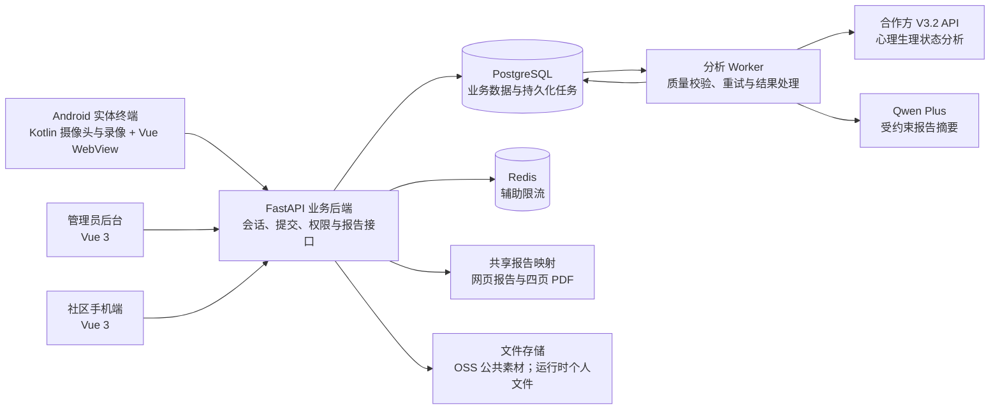

# AI 心理状态辅助测评终端

面向航空与社区场景的软硬件一体化测评项目，覆盖 **Android 实体终端、业务后端、管理员后台、社区手机端和 PDF 报告**。项目将合作方心理生理状态算法接入完整业务流程，让使用者能够完成测评、等待分析、查看报告，并获得后续服务入口。

**落地阶段：已在 Firefly RK3568 Android 实体终端部署并完成流程验证，具备真实 V3.2 算法接入能力，目前处于交付准备阶段。** 社区支付仍使用模拟链路，生产部署与正式商用验收尚未完成。

> 本项目用于心理状态辅助筛查，不构成临床诊断、岗位胜任结论或飞行适航结论。

快速阅读：[项目概览](#项目概览) · [产品问题与解决方式](#产品问题与解决方式) · [产品与工程工作](#产品与工程工作) · [系统架构](#系统架构) · [验证证据](#验证证据与展示边界) · [产品演进](#产品演进规划) · [本地启动](#本地启动)

## 项目概览

| 项目要点   | 当前实现                                                             |
| ------ | ---------------------------------------------------------------- |
| 使用场景   | 航空人员测评、社区心理健康服务；共用采集与报告能力，分别组织入口和服务流程                            |
| 实体设备   | Firefly RK3568 / Android 11；Kotlin 原生摄像头与录像，WebView 承载 Vue 界面    |
| 核心交互   | 三道可跳过预训练、60 秒正式采集、作答后进入下一题、语音与位置提示                               |
| 算法集成   | V3.2 视频上传、任务创建、轮询、结果校验与持久化；支持 Real / Mock 切换                     |
| 报告闭环   | 管理员双场景记录、个人四页报告、社区手机查看与四页 PDF 预览/下载                              |
| 社区基础服务 | 11 项心理自测、23 篇阅读资料、情绪放松工具、咨询预约与求助入口                               |
| 技术实现   | Vue 3 / TypeScript / FastAPI / PostgreSQL / Redis / Kotlin / OSS |

## 产品问题与解决方式

### 将算法采集约束转化为可完成的用户流程

合作方要求约 60 秒的有效视频，而固定题目和等待切题容易让使用者困惑。测评采用自定节奏：用户选择后进入下一题，正式采集按独立时钟运行，题目不重复；题池耗尽时进入收尾引导。预训练帮助用户熟悉操作，最后 5 秒提供结束提示，人脸位置异常时提供文字和语音引导，采集有效性由状态与质量规则判断。

### 将异步分析组织成完整报告服务

视频提交后先提供明确的处理状态和报告凭证，算法分析通过后台任务执行。管理员可按场景查看记录，个人端仅展示授权报告；社区手机端保留本次访问凭证，返回报告中心后可以恢复查询。模拟支付场景包含会话恢复入口，报告生成失败时保留在线查询与错误状态，不发布残缺 PDF。

### 统一不同端的报告解释

管理员、终端个人报告、社区手机报告及 PDF 共用 `frontend/shared/report-kit` 的核心映射。报告按综合概览、方向筛查、核心状态和数据证据组织；缺失数据明确展示。合作方提供专业结果，Qwen Plus 只生成受约束的通俗摘要，不重算分数或作诊断。

### 减少实体终端使用中的中断与误操作

围绕横屏触控、系统输入法、字体对比度、摄像头比例和页面返回方式完成体验调整。图题与音频在准备阶段加载，正式切题复用本次临时素材；退出时释放素材。语音按优先级与当前阶段调度，跳过预训练或切题时取消过期播报；提交使用幂等凭证，后台任务提供重试和租约恢复。

## 产品与工程工作

本项目的工作覆盖需求梳理、流程设计、工程集成和实体设备验证，仓库中的代码与测试对应以下交付内容：

- **产品流程与场景设计**：梳理航空、社区的身份录入、知情同意、测评准备、采集、报告和服务路径，明确共用能力与场景差异。
- **终端与业务系统集成**：连接 Android 原生录像与 WebView 业务页面，建设前后端接口、数据库模型和管理员双场景记录。
- **外部 AI 能力接入**：以独立 Provider 层隔离合作方协议，组织上传、异步任务、结果校验和受约束摘要生成。
- **报告产品化**：统一多端指标口径、固定报告编号、个人访问范围与 PDF 分页，并处理等待、失败、重试和恢复路径。
- **体验迭代与验证**：根据实际终端试用反馈调整交互与视觉，通过流程、音频、素材加载、报告权限和数据存储测试覆盖关键异常。

外部合作方提供心理生理状态算法，本仓库负责业务产品化与系统集成；数字人面试、语音识别和招聘评分属于下述 2.0 规划范围。

主要实现与验证入口：

- [Android 终端与摄像头桥接](android/app/src/main/java/com/psych/terminal/bridge/AndroidCameraBridge.kt)
- [航空测评流程](frontend/terminal-web/src/composables/useAviationFlow.ts) / [社区测评流程](frontend/terminal-web/src/composables/useCommunityFlow.ts)
- [合作方 Provider](backend/app/services/v3/provider.py) / [真实接口客户端](backend/app/services/v3/real.py)
- [共享报告映射](frontend/shared/report-kit) / [PDF 生成与分页校验](backend/app/services/pdf/report.py)
- [社区报告闭环测试](backend/tests/test_community_report_center.py) / [语音调度回归](frontend/terminal-web/tests/communityVoice.test.ts) / [素材加载回归](frontend/terminal-web/tests/sessionImageCache.test.ts)

## 系统架构



采集在终端完成，算法分析通过云端 API 完成。数据库保存结构化结果与任务状态，Redis 不承担当前持久化分析队列。OSS 公共素材已接入；个人文件存储方式可配置；当前项目中的历史个人文件与业务记录已清理。

## 验证证据与展示边界

| 验证范围   | 已有证据                                       | 说明                                        |
| ------ | ------------------------------------------ | ----------------------------------------- |
| 实体终端   | Android APK 部署及摄像头、测评和报告流程调试               | 已完成开发阶段验证，尚未完成长期运行与正式用户验收                 |
| 合作方算法  | 真实 V3.2 接入及结果落库验证；另有模拟传输协议测试               | 真实集成与 Mock 演示区分，不代表自研算法或临床效度验证            |
| 社区报告闭环 | 独立演示数据库下的会话、模拟支付、模拟采集、手机查看及 PDF 验证         | 真实微信支付和生产手机身份接入尚未开通                       |
| 自动化回归  | 2026-10-16 后端 115 项通过、1 项跳过；三个前端合计 125 项通过 | 同次 Python 静态/格式检查、前端类型检查与构建通过；不作为客户数或使用人数 |

仓库保留的[航空场景图](assets/presentation/aviation-assessment-scene.png)和[社区场景图](assets/presentation/community-assessment-scene.png)为 AI 生成示意，不作为实体部署照片或客户使用证明。真实报告、面部附件、内部协议与访问凭证不在公开展示范围内。

## 产品演进规划

下一阶段 **Mr.H 2.0 数字人面试官** 已形成产品与技术方案，尚未在本仓库实现。规划重点包括：

- 复用会话、采集、算法适配与报告能力，面向单岗位结构化面试设计核心问题、限定追问范围和人工复核流程。
- 评估数字人 SDK 与 Windows 展示终端，将形象渲染、口型和播报与 ASR、LLM、TTS、面试状态机分工，保留异常降级路径。
- 分开呈现回答证据、岗位能力评价与心理状态辅助信息，以岗位专家和实际验证建立评价依据；最终招聘决定由人负责。

该部分作为产品演进与方案设计记录，不表示数字人、实时语音面试、招聘评分或云端生产部署已经交付。

以下保留项目状态、技术说明、部署步骤和维护入口，便于复现与后续接入。

## 当前状态

截至 **2026-10-08**，航空与社区的主要页面、测评流程、报告呈现及社区手机查看/PDF 链路已形成完整的当前版本，为后续接入和部署提供基础。

现有项目包含 Firefly RK3568 混合 APK、真实 V3.2 客户端及管理报告。正式支付、生产部署和真实环境稳定性验收仍需后续完成。

### 当前版本与后续维护

- 固定航空与社区入口、身份/会话准备、知情同意、人脸就位、三道可跳过预训练、60 秒正式采集和完成流程。
- 固定管理员双场景记录、个人四页报告、社区手机报告中心与四页 PDF，以及心理自测、科普阅读、情绪放松和求助入口。
- 社区支付继续使用模拟链路；咨询预约的正式开通由配置控制。演示流程不能作为真实支付或社区接待已开通的凭据。
- 后续只进行合作方接口适配、生产配置与部署、必要的问题修复和验收；若合作方改变采集要求或结果定义，再评估相应流程/报告调整。
- GitHub 保存源码、依赖声明与前端锁文件、数据库迁移、内容种子及公共素材来源/清单。网页构建、依赖安装目录、真实密钥、数据库备份、个人报告、面部附件、采集视频和 APK 不随源码提交。
- 2026-10-16 已清空开发数据库中的历史测评、身份、订单、会话及任务记录，删除本地个人媒体、报告和数据库备份。数据库结构及公共题库保留；OSS 核查未发现个人媒体或数据库备份对象。

重新运行时，先由 `.env.example` 创建并填写本地 `.env`，安装依赖、启动 PostgreSQL/Redis、构建三个前端，并核对 OSS 公共素材配置。当前源码不包含历史测评数据及其备份，也不包含本机真实凭证。

### 已完成

- FastAPI、PostgreSQL、Redis、SQLAlchemy 异步后端
- Vue 3 + TypeScript + Vite 模块化测评端和管理后台
- 身份录入、知情同意、人脸定位、60 秒测评与完成页
- Firefly Android 11 混合 APK
  - Camera2 采集前置 RGB 摄像头
  - MediaCodec 硬件编码 1920×1080、30fps、H.264
  - MP4 不采集麦克风和音频轨
  - WebView 复用在线业务页面
- 真实 V3.2 全链路：视频上传、任务创建、轮询、结果和时间轴获取
- V3.2 结构化结果落库与四页管理报告
- Qwen Plus 受约束摘要：只解释合作方结果，不重算分数、不生成诊断
- 航空情境草案题库：6 类题型、每类 4 张真实航空图片，共 24 张，图片由 OSS 托管
- 6 段预生成题目语音，同类图片复用同一段语音，现场不依赖云端 TTS
- 我方私有 OSS 备份与合作方分析上传相互独立
- 管理员查看、搜索、备注、信息编辑与状态流转
- 前端资源本地化、1280×800 横屏触控适配和原生启动屏
- 正式入口与构建目录统一：`/login/` 对应 `static/terminal/`，`/admin/` 对应 `static/admin/`
- 代码检查与回归入口：`make check`；三个前端均支持 `npm test`、`npm run type-check` 和 `npm run build`。
- 社区功能模块：11 项心理自测（10 份筛查量表和 1 组生活感受问答）、23 篇科普/课程/求助阅读资料，以及呼吸练习、自然风声、身体放松和轻挥果园；内容版本与素材来源分别保留在数据库种子和来源记录中
- 双场景管理员记录与报告编号、个人报告查询、手机会话恢复、报告预览及四页 PDF 下载

### 待完成

- 航空心理学合作方对题库内容、维度和表达进行正式审定
- 阿里云 ECS、域名、HTTPS 和生产环境部署
- 完善现有管理员/复核员权限的生产级 RBAC、敏感字段加密、审计与密钥管理
- 现有数据库持久化任务的独立 worker 部署、监控告警和容量验证
- 社区正式手机身份验证、微信支付与咨询预约接待流程
- 未来生产环境的私有文件存储、备份保留与恢复策略，以及对应生产配置
- APK Kiosk 模式、开机自启、看门狗和断网补传
- 多轮真机稳定性测试、异常恢复测试和用户验收

## 系统流程

```text
被测者
  → /login/
  → 身份录入 → 知情同意 → 人脸定位
  → 60 秒航空情境测评与视频采集
  → 提交视频和答题行为 → 完成页

后端
  → 保存测评记录 → 上传合作方 V3.2
  → 轮询分析任务 → 保存结构化结果与时间轴
  → 生成受约束报告摘要

管理员
  → /admin/ → 查看列表与四页报告
  → 添加备注并更新跟进状态
```

摄像头在知情同意后开启，用于人脸定位；只有检测到单人面部并保持在引导框内，才允许开始测评。正式录像仅在测评开始后启动，在约 60 秒流程结束时停止。项目不采集麦克风，不申请录音权限。

## 报告结构

管理报告以合作方 V3.2 结构化结果为唯一专业数据来源。Qwen Plus 只负责受约束的语言整理，不修改数值、档位、分类和参考信息。

| 页面   | 内容                             |
| ---- | ------------------------------ |
| 综合概览 | 汇总数据有效性、核心状态、方向筛查结果和本次重点       |
| 方向筛查 | 展示抑郁、焦虑方向的合作方分类及解释边界           |
| 核心状态 | 展示压力负荷、疲劳/恢复负荷、生理唤醒线索和视觉注意力    |
| 数据证据 | 展示数据质量以及 AU、Vibra、rPPG、眼动等辅助证据 |

数据证据页内部按 AU、Vibra、rPPG 和眼动四类来源组织，仍属于同一个报告页面，不再作为独立报告页重复展示。

报告遵守以下原则：

- 抑郁和焦虑只作为方向筛查，不等同于临床诊断
- AU、Vibra、rPPG 和眼动是辅助证据，单项偏高或偏低不直接形成风险结论
- 缺失或未达到质量要求的数据明确标注，不补算、不虚构
- 不使用一次视频结果判断人格、攻击性、岗位胜任或飞行适航

## 航空情境题库

航空采用 60 秒自定节奏图题测评：用户作答后进入下一题，不再固定六题或每题十秒。三道预训练可跳过，正式题池由服务端分配，实际题目数量以启用中的题库为准。

被测者进入知情同意页时，前端获取本次题组并提前准备素材；素材未就绪时不能进入测评，失败时提供重新加载。正式题不循环，题池耗尽进入收尾引导，采集仍按 60 秒协议完成。

社区采用相同的预训练与正式采集流程，正式池请求上限 30 道、最低可用 24 道。服务端按题干和图片去重，并排除预训练内容；已选题组随会话保存。图片在 OSS，终端在测评准备阶段通过后端临时取图，不做长期缓存；采集完成、退出和页面卸载时释放素材。题干、选项和题库状态保存在服务端数据库。

| 类型         | 场景          |
| ---------- | ----------- |
| 注意分配       | 仪表监控与多信息变化  |
| 工作负荷       | 时间压力下的任务处理  |
| 情境意识       | 运行条件与预期发生偏差 |
| 程序与安全意识    | 时间紧张时的程序复核  |
| 机组沟通       | 判断不一致时的协同决策 |
| 情绪调节与决策稳定性 | 异常情境处置      |

资源位置：

- `backend/app/static/assets/aviation/content.json`
- `backend/app/static/assets/aviation/sources.json`
- `backend/app/static/assets/aviation/audio/`

图片文件已发布至 OSS，不在本地静态目录保留副本；`sources.json` 仅保存来源与授权记录。

当前题目为内容与交互草案，不参与合作方 V3.2 心理指标计算，也不能表述为已经完成航空心理学效度验证的正式量表。

```bash
# 发布或更新航空情境题库（上传图片至 OSS 并替换旧图片题库）
python scripts/seed_aviation_bank.py

# 重新生成六段本地题目语音
python scripts/generate_aviation_audio.py
```

## 项目结构

```text
psych-project/
├─ backend/
│  ├─ app/
│  │  ├─ api/routes/          # 测评、图题、管理和健康检查接口
│  │  ├─ core/                # 配置与日志
│  │  ├─ db/                  # 数据库连接与会话
│  │  ├─ models/              # 测评、结果和图题模型
│  │  ├─ schemas/             # 请求与响应模型
│  │  ├─ services/
│  │  │  ├─ assessment.py    # 测评任务编排
│  │  │  ├─ scheduler.py     # 图题会话调度
│  │  │  ├─ v3/              # V3.2 Mock/Real Provider
│  │  │  ├─ qwen/            # 受约束报告摘要
│  │  │  └─ oss/             # 对象存储
│  │  ├─ static/              # 前端构建产物和本地静态资源
│  │  └─ main.py             # FastAPI 入口
│  ├─ tests/
│  └─ migrations/            # 数据库增量迁移
├─ frontend/
│  ├─ terminal-web/           # 测评端 Vue 3 + TypeScript
│  ├─ admin-web/              # 管理后台 Vue 3 + TypeScript
│  ├─ community-web/          # 社区手机支付/报告入口
│  └─ shared/report-kit/      # 管理端、个人报告和 PDF 共用映射
├─ android/                   # WebView + Camera2 + MediaCodec 混合 APK
├─ scripts/                   # 环境、题库、语音和部署辅助脚本
├─ data/                      # 本地运行数据
├─ docker-compose.yml
├─ .env.example
└─ README.md
```

## 技术栈

- 后端：Python 3.12、FastAPI、SQLAlchemy 2.0 Async、Pydantic Settings
- 数据库与缓存：PostgreSQL 16、Redis 7
- 前端：Vue 3、TypeScript、Vite、Vue Router、Pinia
- Android：Kotlin、WebView、Camera2、MediaCodec、MediaMuxer
- 算法与表达：合作方 V3.2、阿里云百炼 Qwen Plus
- 存储：阿里云 OSS
- 基础设施：Docker Compose、Adminer
- 质量工具：pytest、Ruff、vue-tsc、Vite

## 页面入口

| 地址                             | 说明             |
| ------------------------------ | -------------- |
| `http://localhost:8000/login/` | 正式测评入口         |
| `http://localhost:8000/admin/` | 管理后台与报告中心      |
| `http://localhost:8000/docs`   | Swagger API 文档 |
| `http://localhost:8000/health` | 服务和数据库健康检查     |
| `http://localhost:8080`        | Adminer 数据库管理  |

## 数据与文件存储

- PostgreSQL 保存测评、结构化结果、题库文字、订单、会话、预约、备注，以及量表/阅读内容的版本（`content_versions`）。
- OSS 公共素材使用 `static-assets/`；图题图片仍由 `images` 与 `pairs` 关联。`stored_assets` 记录文件位置、类型、大小、SHA-256 和已验证的访问级别。
- 个人 PDF、AU 附件、视频和数据库备份上传时直接设置私有对象 ACL，并验证匿名访问被拒绝和完整内容校验值。报告接口鉴权后生成短期链接，数据库保存稳定对象 key。
- `REPORT_STORAGE_MODE=local|oss` 单独控制报告与附件；`OSS_BACKUP_ENABLED` 单独控制采集视频备份。上传失败继续保留本地 PDF，并由后台补传。
- 仓库保留程序、模板及必要的公共资源；运行时可创建临时文件。2026-10-16 的清理已删除旧媒体、报告、日志和备份，迁移脚本本身仍不会自动删除源文件。
- 当前开发库历史个人数据已清理，保留结构和公共题库；数据库未迁移至云端。


```bash
# 只读查看待整理数据
python scripts/organize_storage.py
# 仅整理公共内容和素材；不上传个人数据
python scripts/organize_storage.py --public-only
# 确认敏感文件上传目的地和范围后：备份、校验文件并更新数据库引用
python scripts/organize_storage.py --apply
# 只生成并验证本地备份，不上传任何敏感文件
python scripts/organize_storage.py --local-backup
# 生成并私有发布一份数据库备份，验证其 PostgreSQL archive 目录
python scripts/organize_storage.py --backup-only
```

公共素材可以单独运行 `backend/scripts/migrate-static-assets.mjs`；完成后运行 `--public-only` 校验并登记文件。量表和科普种子由 `scripts/build-community-library.mjs` 从终端共用内容导出，`--public-only` 发布新版本；历史版本保留。终端优先读取数据库版本，接口不可用时使用自带版本，量表作答开始后固定该次版本。

## 源码与运行数据

本目录已按源码交付方式整理。保留后端、三个前端、Android 工程、测试、数据库迁移、配置模板和必要公共资源；内部调研/协议/个人报告、日志、数据库备份、依赖安装目录和网页构建产物不保留在本项目目录中。

`.env` 与本机证书已移除；请自行配置开发或生产凭证。`backend/app/static/{terminal,admin,community}` 由前端构建生成。运行前先安装依赖并构建，不能直接把源码目录视为已部署服务。算法 fixture 为不含个人身份和真实媒体链接的接口测试样例。

## 本地启动

项目主要在 WSL2 中运行。

```bash
# Python 环境
python -m venv .venv
source .venv/bin/activate
cd backend
pip install -e ".[dev]"
cd ..

# 环境变量
cp .env.example .env

# PostgreSQL、Redis、Adminer
docker compose up -d

# 后端
.venv/bin/uvicorn app.main:app --host 0.0.0.0 --port 8000 --app-dir backend
```

前端构建：

```bash
npm --prefix frontend/terminal-web ci
npm --prefix frontend/terminal-web run build

npm --prefix frontend/admin-web ci
npm --prefix frontend/admin-web run build

npm --prefix frontend/community-web ci
npm --prefix frontend/community-web run build
```

前端构建产物由后端托管，正式入口保持 `/login/` 和 `/admin/` 不变。

如果 WSL 重启后 Windows 或局域网设备无法访问后端，在 Windows PowerShell 中运行：

```powershell
powershell -ExecutionPolicy Bypass -File .\scripts\update-wsl-portproxy.ps1
```

## V3.2 配置

Mock 模式用于本地界面和流程验证：

```dotenv
PROVIDER_MODE=mock
```

真实 V3.2：

```dotenv
PROVIDER_MODE=real
V3_API_ROOT=https://example.com
V3_BASIC_TOKEN=xxx
V3_ALG_SERVICE_UUID=xxx
```

Mock 数据必须明确标识为演示数据，不代表被测者真实心理状态。正式报告只使用真实 V3.2 结果。真实密钥只保存在本地 `.env`，不得写入代码、README、日志或截图。

### 后续接入合作方 API

合作方逻辑集中在 `backend/app/services/v3/`，通过 `V3Provider` 隔离，业务编排、界面和报告无需直接调用合作方接口。当前真实客户端已实现文件登记、视频直传、创建任务、状态轮询及结果解析。

1. 核对合作方当前接口文档与采集要求：视频时长、编码、分辨率、帧率、人脸有效性，以及结果字段、单位、参考区间和使用边界。
2. 如继续使用现有 V3.2 协议，配置 `PROVIDER_MODE`、`V3_API_ROOT`、`V3_BASIC_TOKEN`、`V3_ALG_SERVICE_UUID`、`V3_OSS_BUCKET_ID` 和轮询参数，再完成真实联调。配置正确不等于接口验收完成。
3. 如协议变化，修改 `v3/real.py` 或新增 Provider；如结果字段变化，同步调整结果校验与 `frontend/shared/report-kit` 映射。不得把缺失指标补零，也不得用模拟结果替代正式报告。
4. 验证成功、排队、超时、失败与重试，以及航空/社区结果落库、管理员/个人报告和 PDF 的一致性；最后在实体终端确认采集和异常恢复。

现有测试入口为 `backend/tests/test_v3_real.py`、`test_v3_provider.py`、`test_v3_result_validity.py` 和报告/处理流程测试。客户端协议测试使用模拟 HTTP 传输，不代替合作方真实环境验收。若合作方改变采集协议，可能需要调整 Android 采集及测评流程，不能承诺任意 API 都只填密钥即可接入。

## API 概览

| 方法      | 路径                                             | 说明           |
| ------- | ---------------------------------------------- | ------------ |
| `GET`   | `/health`                                      | 服务和数据库健康状态   |
| `GET`   | `/api/v1/pairs/session?count=6`                | 获取本次图题会话     |
| `POST`  | `/api/v1/assessments/submit`                   | 提交身份、视频和答题行为 |
| `POST`  | `/api/v1/assessments/{id}/resubmit`            | 重新提交失败任务     |
| `GET`   | `/api/v1/assessments`                          | 查询测评列表       |
| `GET`   | `/api/v1/assessments/{id}`                     | 查询测评详情和报告    |
| `POST`  | `/api/v1/admin/login`                          | 管理员登录        |
| `PUT`   | `/api/v1/admin/assessments/{id}/info`          | 修改基础信息       |
| `PATCH` | `/api/v1/admin/assessments/{id}/note`          | 修改内部备注       |
| `PATCH` | `/api/v1/admin/assessments/{id}/review-status` | 更新跟进状态       |

## 更新方式

- 测评页面、管理后台和普通业务逻辑：重新构建前端或重启后端，APK 通常无需重装
- Camera2、MediaCodec、WebView Bridge 等 Android 原生代码：重新构建并安装 APK
- 题库：更新配置和静态资源后重新导入
- 报告表达：修改管理前端或 Qwen 受约束摘要规则，不修改合作方原始结果

## 静态媒体迁移到 OSS/CDN

运行时媒体默认复用现有 OSS Bucket 与凭证，放入独立的 `static-assets/` 前缀并逐对象设为公共读。不会改变整个 Bucket 的读权限；报告、测评视频等已有对象保持原状。也可以用 `ASSET_OSS_*` 覆盖成独立 Bucket。

1. 默认复用根目录 `.env` 里已有的 `OSS_ACCESS_KEY_ID`、`OSS_ACCESS_KEY_SECRET`、`OSS_ENDPOINT` 和 `OSS_BUCKET_NAME`。如需独立 Bucket，再填写 `ASSET_OSS_*` 覆盖项。
2. 先生成本地清单：`node backend/scripts/migrate-static-assets.mjs`。默认写入根目录 `static-assets-manifest.json`，记录源路径、OSS 对象键、大小和 SHA-256，不会上传文件。
3. 运行 `node backend/scripts/migrate-static-assets.mjs --upload`。文件放入 `static-assets/` 前缀、逐对象公共读，脚本会逐一检查匿名访问和文件大小；源文件会保留。
4. 可选：配置 CDN 指向该 Bucket，并在 `.env` 设置 `ASSET_CDN_BASE_URL`，例如 `https://static.example.com`。没有 CDN 地址时，后端直接使用 OSS 域名。
5. 在 OSS/CDN 上抽查图片、WAV/MP3 和 MP4。确认终端和社区场景设备都能访问后，再从部署包和 Git 中移除已迁移的源媒体；Android 独立 drawable 资源不在本次清单内。
6. 删除本地源文件前运行 `node backend/scripts/migrate-static-assets.mjs --prune-local`。此命令会再次校验 OSS 对象和本地 SHA-256，通过后才删除清单内文件；以后用 `node backend/scripts/migrate-static-assets.mjs --download` 按原目录与 SHA-256 完整恢复。修改或重建场景素材前先恢复资源。已有清单比本地媒体多时，普通运行会拒绝覆盖它。

清单包含 `backend/app/static/assets` 与 `community-assets` 下的图片、音频和视频文件，不包含脚本、字体、前端代码或用户上传数据。

## 测试

```bash
cd backend
pytest -q
ruff check .

cd ../frontend/terminal-web
npm run build

cd ../admin-web
npm run build
```

Android 单元测试和 APK 构建方式见 `android/README.md`。

当前版本的验证结果见下方记录；后续改动应重新执行 `make check` 和相关构建。代码检查及模拟测试不替代实体终端和合作方真实接口验收。

2026-10-16 清理前验证：后端 `115 passed, 1 skipped`；测评端 95 项、管理端 24 项、社区手机端 6 项测试通过。Python 静态检查/格式检查、三个前端类型检查及构建通过。后端另有一条第三方 Starlette/httpx 弃用警告。此次未重新执行实体终端、Android 构建或合作方真实算法测试。

Windows 下运行 `powershell -NoProfile -ExecutionPolicy Bypass -File scripts/clean-project.ps1`

可预览缓存清理范围，加 `-Apply` 执行。仅清理代码缓存和 Android 构建产物；

数据库、上传视频、报告、参考资料、资源母带和后端正在提供的前端构建均不在清理范围内。

## 合规与安全

- 知情同意覆盖敏感个人信息、视频采集、用途、保存和非诊断声明
- 身份证在管理接口和页面中默认脱敏显示
- 测评完成后清除终端身份状态，个人报告仅展示本人的结果，不展示管理备注等内部信息
- 管理接口要求管理员会话
- `.env`、视频、报告原始数据和真实凭证禁止提交 Git
- 正式公网部署前必须完成 HTTPS、RBAC、敏感字段加密、审计和备份策略

## 报告中心与 PDF

社区首页“查看报告”进入 `/community/reports?terminal=1`，按固定的 8 位报告编号查询。

手机支付页保留本次会话链接；完成后自动进入单份报告，可预览或下载 PDF。分享令牌仅能访问该份社区报告，有效期 7 天；终端不恢复手机登录和上一位用户的数据，5 分钟无操作清屏。

PDF 的内容映射直接复用 `frontend/shared/report-kit`，通过三个前端的构建前置步骤打包为 `backend/app/services/pdf/report-kit.mjs`。后端需要 Node.js 18+ 和现有 WeasyPrint。PDF 生成失败会保留在线报告，不生成不完整的替代报告。PDF 固定四页，每个主题单独一页；生成时检查实际分页，无法完整排入四页时明确失败，不裁剪正文或发布接近空白的溢出页。

当前编号直查和会话领取仅在非生产环境启用；`ENV=prod` 下必须走已验证的手机身份。公众号、短信验证与真实支付仍属于正式上线接入项。

闭环验证：`backend/tests/test_community_report_center.py`。浏览器全流程演示使用 `backend/scripts/report_center_qa_server.py`（独立 `psych_report_qa` 数据库、localhost:8001、人脸与结果模拟、不调用真实算法），配合 `node scripts/report-center-qa.mjs`。测试产物在 `outputs/report-center-qa/`。
